<!--
  QchuDev · GitHub profile README
  Style: cartoon white + orange (#FF9A00), marker font (Patrick Hand).
  Section titles are rendered PNGs (see .build/make_titles.py) because GitHub
  does not allow web fonts in Markdown.
  Character images are self-contained animated SVGs with a floaty bob + a subtle
  scale "breath" (see .build/make_float.py) — GitHub plays CSS @keyframes inside
  -loaded SVGs. The games carousel and contribution heatmap are animated
  SVGs too (.build/make_carousel.py, .build/make_heatmap.py).
-->

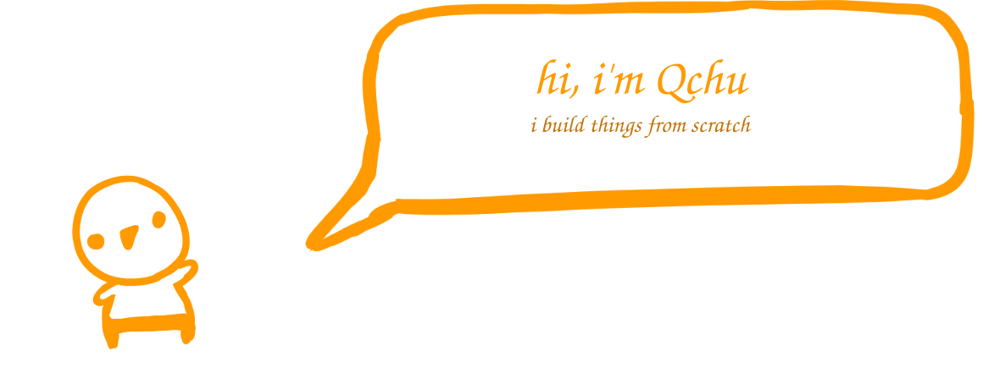

 

 

---

<!-- ===================== ABOUT ===================== -->

<table border="0">
<tr>
<td width="78%" valign="top">

I'm **Juan José Seré** — a third-year **Software Engineering** student
(Universidad Austral,  Buenos Aires, Argentina).

I like understanding things *from the ground up*: that's why I end up writing
engines, neural networks and flight software **from scratch** instead of gluing
libraries together. I'm comfortable both at a high level (**Java / Spring,
Python**) and close to the metal (**C, C++**).

-  I write flight software for a rocket on the **Rocketry team (AAT)** — Kalman filtering and sensor fusion in C.
- 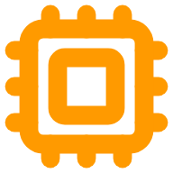 I'm obsessed with **building my own engines**: graphics, physics, ECS, parsers and DSLs.
- 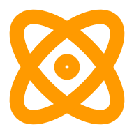 Outside my degree I self-study **quantum mechanics and quantum computing** (Qiskit / AWS Braket).
-  I tutor **math, algebra and physics**.

</td>
<td width="22%" valign="middle" align="center">
  
</td>
</tr>
</table>

 

---

<!-- ===================== STACK ===================== -->

<table border="0">
<tr>
<td width="26%" valign="middle" align="center">
  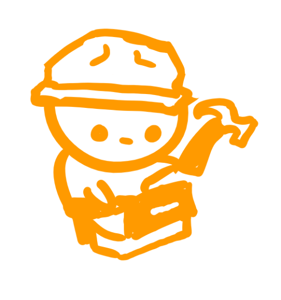
</td>
<td width="74%" valign="middle" align="center">
  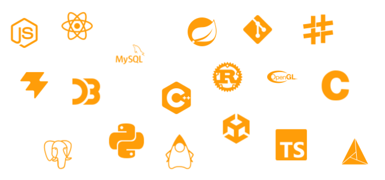
</td>
</tr>
</table>

 

---

<!-- ===================== PROJECTS ===================== -->

<table border="0">
<tr>
<td width="50%" valign="top">

###  Animine
A 3D animation & visualization engine **from scratch**, with a custom
scene-description DSL + parser, keyframes (easing, Catmull-Rom), hierarchical
transforms and hot-reload.
 `C++17 · OpenGL · GLSL · GLM · CMake`

</td>
<td width="50%" valign="top">

### 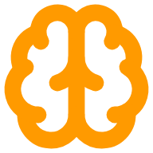 Brab
A **neural-network** library and API built from scratch: training, persistence
and inference.
 `Rust`

</td>
</tr>
<tr>
<td width="50%" valign="top">

###  SmolPet
A desktop virtual pet with my own **ECS** engine: fixed-timestep physics,
particles, an FSM and a transparent always-on-top window via Win32.
 `Python · Pygame · Win32 API`

</td>
<td width="50%" valign="top">

###  Game Dev
Years of Unity/Godot prototypes and game-jam entries — gameplay, animation and
asset design. See the reel below.
 `C# · Unity · Godot`

</td>
</tr>
</table>

 

<!-- ===================== GAMES CAROUSEL ===================== -->

 

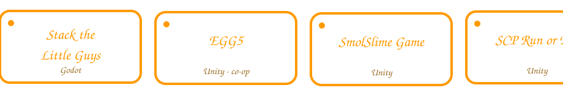

 

---

<!-- ===================== QUANTUM ===================== -->

<table border="0">
<tr>
<td width="20%" align="center" valign="middle">
  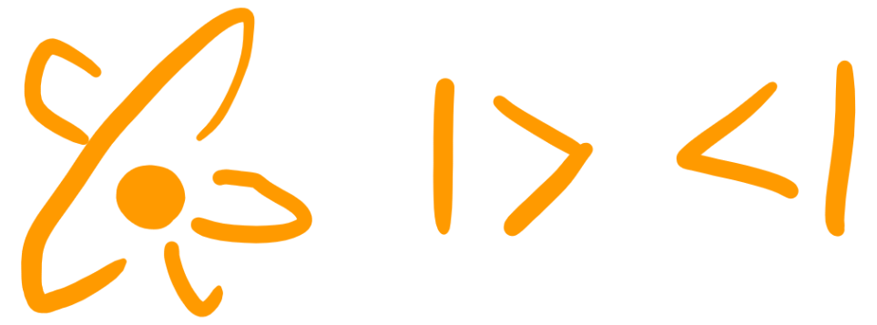
</td>
<td width="80%" valign="middle">

When I'm not coding, I'm reading about **superposition, entanglement and
qubits**. I self-study the fundamentals of quantum mechanics and quantum
computing, playing with **Qiskit (IBM Quantum)** and **AWS Braket**.

It's my favorite *side quest*: where `0` and `1` stop being mutually exclusive.

</td>
</tr>
</table>

 

---

<!-- ===================== STATS (hand-drawn heatmap) ===================== -->


 

---

<!-- ===================== CONNECT ===================== -->

<table border="0">
<tr>
<td valign="middle" align="center">
  <a href="https://www.linkedin.com/in/juan-jos%C3%A9-ser%C3%A9-81348030b/">
    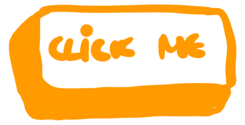
  </a>
</td>
<td valign="middle" align="center">
  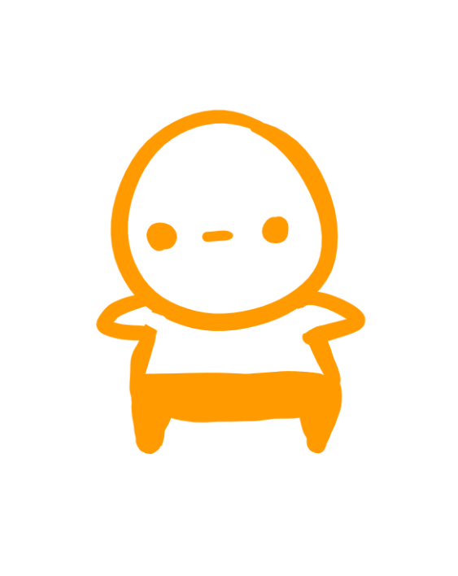
</td>
</tr>
</table>

